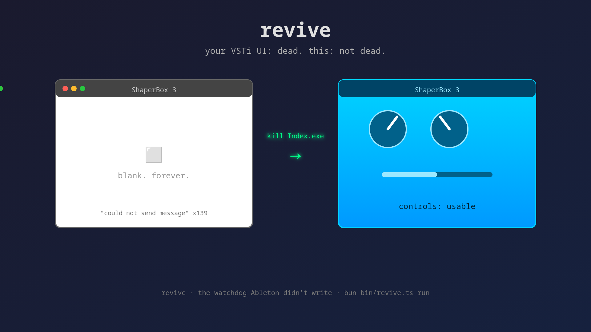

# revive

<div align="center">

[](LICENSE) [](https://github.com/toxicwind/revive) [](https://github.com/toxicwind/revive/issues)

**Ableton Live plugin-UI recovery watchdog.** It fixes the bug you've been "living with for several months."

</div>

<p align="center">
  
</p>

---

## Yes. It's that bug. The one you've been rage-googling.

> *"I have to keep the plugin open all the time, otherwise the GUI dies when I close it."*
> — **vtarasuk**, [JUCE forum](https://forum.juce.com/t/blank-white-screen-after-plugin-was-closed-and-opened-again/59281)

> *"The controls and UI are invisible and unusable. It seems like VSTs that use OpenGL have this issue."*
> — **jbone1313**, [Ableton forum](https://forum.ableton.com/viewtopic.php?t=238228)

> *"The plugin's editor window displays correctly the first time. However, if the editor window is closed and then reopened, it appears completely blank (just white)."*
> — **ring2**, [JUCE forum](https://forum.juce.com/t/auv3-plugin-editor-window-shows-blank-white-when-reopened-in-ableton-live-12/67135)

**That's you.** Load a VSTi → it works → close the UI → it's dead forever. A blank white rectangle where your synth used to be. Reported since 2020. Still broken. Congratulations, you found the one bug Ableton and every plugin vendor have been ignoring for half a decade.

## What's actually happening (the boring truth)

The plugin *still makes sound* — it's not broken, it's just **refusing to show its face.** Ableton's plugin-metadata IPC channel (a nanomsq pipe to its `Ableton Index.exe` subprocess) has wedged. Every time you reopen the editor, Ableton fires a `ReimportMetadataForPlugin` message into the dead channel and it bounces.

Your `Log.txt` looks like this:

```
warning: TNanoMsgIPCChannel: could not send message: ReimportMetadataForPlugin
warning: Last message repeated 139 time(s): TNanoMsgIPCChannel: could not send message: ReimportMetadataForPlugin
```

139 times. In one session. Because Ableton *really* wants to reimport that metadata and the pipe is just *gone.*

## What revive does (and why it works)

It's a watchdog. It reads your `Log.txt`, sees the channel is dead, and **kills the wedged Index subprocess.** That's it. That's the whole trick.

And here's the beautiful part: **Ableton respawns it itself** and reconnects the pipe. The self-heal is right there in the log:

```
error: Indexer: process stopped prematurely [1]. Restart
info:  Indexer: start process
```

So revive isn't patching anything. It's not hacking Live. It's just **the world's most expensive way to tell Ableton "hey buddy, your background process is stuck, maybe restart it"** — and Ableton, for once, listens.

No DLL patching. No proprietary internals. No reverse-engineering voodoo. Just the public `Log.txt` and a kill command. **Windows + macOS.**

## Quick start

```bash
bun install

# One manual pass (detect + recover if needed)
bun bin/revive.ts run

# Dry-run: detect only, touch nothing, judge silently
bun bin/revive.ts check

# Install as a durable scheduled task (logon + every 10 min)
bun bin/revive.ts install

# Remove the scheduled task (go back to living with the bug)
bun bin/revive.ts uninstall
```

## The receipts (everyone who hit this before you)

| They said | Where |
|---|---|
| *"I have to keep the plugin open all the time, otherwise the GUI dies when I close it"* | [JUCE — Blank/White Screen after plugin was closed and opened again](https://forum.juce.com/t/blank-white-screen-after-plugin-was-closed-and-opened-again/59281) |
| *"the controls and UI are invisible and unusable... happens after reloading a saved set"* | [Ableton Forum — Some VST UIs appear blank/white](https://forum.ableton.com/viewtopic.php?t=238228) |
| *"if the editor window is closed and then reopened, it appears completely blank (just white)"* | [JUCE — AUv3 editor blank when reopened in Live 12](https://forum.juce.com/t/auv3-plugin-editor-window-shows-blank-white-when-reopened-in-ableton-live-12/67135) |
| White GUI on many VST3s + other "bizarre" GUI bugs | [Ableton Forum](https://forum.ableton.com/viewtopic.php?t=243314) |
| The official doc that won't help you | [Ableton Help — Plug-ins Tips](https://help.ableton.com/hc/en-us/articles/5232428442002) |

## Where's the Log.txt?

- **Windows**: `C:\Users\<you>\AppData\Roaming\Ableton\Live <ver>\Preferences\Log.txt`
- **macOS**: `~/Library/Preferences/Ableton/Live <ver>/Log.txt`

revive finds the newest one automatically. It's polite like that.

## Roadmap

- [x] First release — detect + recover + scheduled task
- [ ] macOS launchd installer (currently cron best-effort)
- [ ] Configurable extra peers to restart
- [ ] A support ticket that gets answered (unlikely)

## License

MIT. Which is more than the bug's victims got.